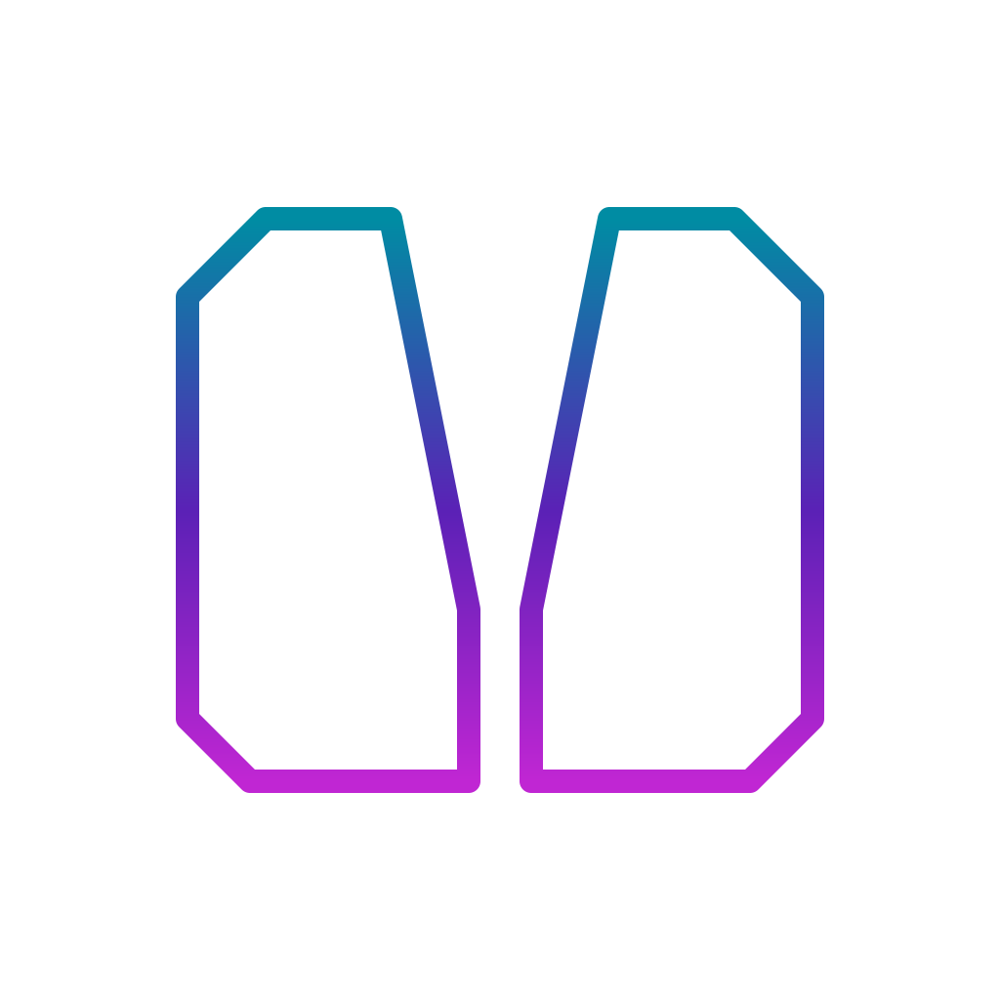

# Vlikeon Browser

<picture>
  <source media="(prefers-color-scheme: dark)" srcset="branding/vlikeon/png/display-1024.png">
  
</picture>

**Gaming Superbrowser by Vlike**

An experimental Chromium-first browser project bringing a game hub, isolated
native engine adapters, save management and remote-play workflows into one
workspace. Vlikeon is the new public name of the project previously called
OmniPlay.

**Status: active development; full browser and production release qualification
remain open.** A separate Windows Game Hub demo has scoped execution evidence.
The integrated source checkpoint passed selected tests and deterministic resource
generation; it is not a complete Chromium browser build. No qualified production
installer, compatibility list or controlled benchmark is available.

[Tiếng Việt](README.vi.md) · [Roadmap](ROADMAP.md) ·
[Contributing](CONTRIBUTING.md) · [Security](SECURITY.md) ·
[License scope](LICENSING.md)

[Transparent logo and platform icon assets](branding/vlikeon/README.vi.md)

## Current evidence and demo

- [Windows demo and its limits](docs/PLAYABLE_DEMO.md): a standalone Win32 window
  with WebView2, an original Game Boy game and a WebAssembly core. It is a
  separate technical demo; current source changes need their own qualification.
- [Source integration checkpoint](docs/SOURCE_INTEGRATION.md), commit `35f3271`:
  53 Rust, 13 JavaScript and 19 Python cases passed; four Windows fixture cases
  remain ignored. The synthetic audio contract and fixture-configured native
  worker/helper build passed. Development regeneration reproduced 435 files.
- [Ordered outstanding work](docs/OUTSTANDING_WORK.md): current 1–109 task
  identifiers. Older 1–17 numbers describe product areas, not this task list.

Evidence applies to its recorded inputs and scope. These counts overlap earlier
verification batches and must not be added as new distinct coverage.

## What we are building

- A browser and game hub with a consistent library and session workflow.
- Permission-scoped native runtime integration and explicit resource ownership.
- Save import, recovery and encrypted synchronization workflows.
- Remote-play coordination and desktop, mobile and web product surfaces.
- Reproducible source preparation with pinned dependencies and explicit
  distribution admission for third-party engines.

These describe intended behavior and authored source areas, **not verified
shipping features**. Desktop and Android target Chromium integration; iOS source
targets WebKit. Device, platform, compatibility and release qualification remain open.

## Start here

1. Read the [current status](docs/PUBLIC_STATUS.md) and [roadmap](ROADMAP.md).
2. Explore the source map below and [architecture](docs/ARCHITECTURE.md).
3. Read [CONTRIBUTING.md](CONTRIBUTING.md) before proposing a change.
4. Review [licensing boundaries](LICENSING.md) before distributing any build.

This is a source-review entry point. A clean-clone build has not been verified;
there is no supported end-user installation command yet. Tools and recipes are
authored source; exact executed scopes are recorded in the evidence above.
Antigravity executes assigned checks; Codex reviews results and owns fixes.

## Source map

| Directory | Responsibility |
| --- | --- |
| `browser/` | Chromium pins, reference snapshots, patches and integration |
| `apps/` | Game hub, web, Android and iOS product surfaces |
| `platform/` | Rust contracts, broker, storage and platform/runtime boundaries |
| `engines/` | Native, web and streaming runtime integration |
| `services/` | Account, encrypted synchronization and signaling services |
| `security/` | Dependency provenance, release trust and distribution decisions |
| `packaging/` | Platform packaging source and policies |
| `qa/` | Acceptance/test source and scoped execution records under `qa/evidence/` |
| `tools/` | Source acquisition, adaptation, staging and build recipes |
| `docs/` | Architecture, requirements and implementation records |

Large upstream checkouts, generated `out/` snapshots, local data and secrets
are excluded from Git. References to local snapshots are authoring records,
not downloadable releases.

## Contributing

Early contributions can help review lifecycle and containment boundaries,
document build prerequisites, review dependency provenance and improve focused
acceptance cases. Discuss substantial changes before implementation. Do not
upload commercial game assets, manufacturer BIOS, credentials or private saves.

We do not currently claim community adoption, production use, completed audits
or third-party endorsement.

## License and attribution

Original project material without a separate notice is offered under
[Apache-2.0](LICENSE). Existing MIT/ISC notices, Chromium-derived files and all
third-party components retain their own licenses. The root license does not
relicense upstream code or approve combined binary distribution. See
[LICENSING.md](LICENSING.md), [NOTICE](NOTICE) and
[the dependency inventory](security/dependencies.json).

Selected upstream sources include replacement firmware/fonts and embedded
assets requiring review; this repository does not grant rights to game content
or manufacturer BIOS.

Internal names, crate identifiers, protocol fields and paths still use
`omniplay` where changing them requires a separately reviewed migration.
The public naming change does not imply that migration has been completed.
