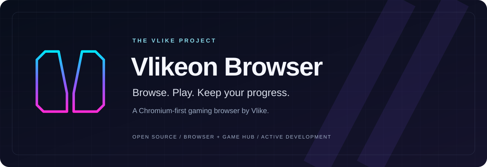

<p align="center">
  
</p>

<p align="center">
  <strong>A Chromium-first gaming browser by Vlike.</strong><br>
  One workspace for the web, your game library and the progress you want to keep.
</p>

<p align="center">
  <a href="docs/PLAYABLE_DEMO.md">Windows demo</a> ·
  <a href="docs/PUBLIC_STATUS.md">Project status</a> ·
  <a href="docs/ARCHITECTURE.md">Architecture</a> ·
  <a href="ROADMAP.md">Roadmap</a> ·
  <a href="CONTRIBUTING.md">Contribute</a> ·
  <a href="README.vi.md">Tiếng Việt</a>
</p>

## A browser built around play

Vlikeon brings browser and game workflows into one open-source project: a shared
Game Hub, permission-scoped engine integration, local save management and
remote-play coordination. Our goal is to make moving between browsing, playing
and returning to a game feel coherent, while keeping ownership and permissions
explicit.

**Active development.** A Windows Game Hub demo is available, and a Windows x64
Chromium development build has completed its recorded build/integrity checks.
The full browser is not a production-qualified release. Platform coverage,
compatibility, security review and release acceptance remain in progress.

## Explore the work

| Area | What we are building | Source |
| --- | --- | --- |
| Browser & Game Hub | A consistent library and session experience alongside the web | [`browser/`](browser/), [`apps/`](apps/) |
| Runtime boundaries | Explicit permissions, session ownership and native/Web engine adapters | [`platform/`](platform/), [`engines/`](engines/) |
| Progress & recovery | Save import, history, recovery and optional encrypted synchronization | [`platform/core/`](platform/core/), [`services/`](services/) |
| Remote play | Host pairing, stream coordination and input lifecycles | [`engines/streaming/`](engines/streaming/) |
| Reproducible delivery | Pinned dependencies, source preparation and reviewed distribution inputs | [`tools/`](tools/), [`security/`](security/) |

These are development areas, not a claim that every feature is ready to ship.
Desktop and Android target Chromium integration; iOS/iPadOS uses WebKit.

## Try the Windows Game Hub demo

The [technical prerelease](https://github.com/lyzaghi/vlikeon/releases/tag/v0.1.0-demo.1)
includes an original Game Boy game in a standalone Win32/WebView2 application.
It demonstrates the game, input, pause and save/resume workflow without requiring
a commercial ROM or an account.

- **Platform:** Windows x64; Microsoft WebView2 Runtime required.
- **Package:** portable ZIP; unsigned executable.
- **Scope:** a standalone Game Hub demo, separate from the full Chromium browser.
- **Instructions, hashes and evidence:** [demo guide](docs/PLAYABLE_DEMO.md).

## Engineering with evidence

We distinguish source implementation, executed checks and release acceptance.
Every result belongs to its recorded revision and environment.

| Checkpoint | Read the evidence |
| --- | --- |
| Windows Chromium development build and output integrity | [Windows build record](docs/WINDOWS_CHROMIUM_BUILD.md) |
| Standalone Game Hub demo behavior | [Demo qualification and limits](docs/PLAYABLE_DEMO.md) |
| Selected shared-source tests and native fixture builds | [Source integration checkpoint](docs/SOURCE_INTEGRATION.md) |
| Remaining implementation and acceptance tasks | [Outstanding work](docs/OUTSTANDING_WORK.md) |

A verified full-product clean-clone build and supported production installation
path are still open. Earlier passing results do not qualify later source changes.

## Understand the architecture

```text
Browser surfaces  →  Game Hub  →  Contracts & permission broker
                                      ├─ Library, saves & recovery
                                      ├─ Native / Web engine adapters
                                      └─ Remote-play coordination
                                               │
                                  Optional accounts & encrypted sync
```

The architecture separates browser requests, file grants, runtime sessions and
save ownership. Read the [architecture map](docs/ARCHITECTURE.md) for the intended
boundaries and the [public status](docs/PUBLIC_STATUS.md) for their current scope.

## Build with us

Contributions are welcome in focused areas: lifecycle and permission review,
build reproducibility, device qualification, accessibility, documentation and
dependency provenance.

1. Read the [contribution guide](CONTRIBUTING.md) and [roadmap](ROADMAP.md).
2. Pick an existing [issue](https://github.com/lyzaghi/vlikeon/issues), or discuss
   a concrete problem before starting a substantial change.
3. Submit a focused pull request with a clear explanation and exact verification
   scope. Source review and reproduced behavior should be identified separately.

For sensitive findings, follow the [security policy](SECURITY.md). Please use
synthetic or permission-cleared fixtures; keep credentials, private saves,
commercial games and manufacturer BIOS out of contributions.

## License & project identity

Original project material is [Apache-2.0](LICENSE), unless a file has another
notice. Chromium-derived material and third-party components keep their own
licenses. See [license scope](LICENSING.md), [NOTICE](NOTICE) and the
[dependency inventory](security/dependencies.json) before distributing binaries.

Vlikeon is the public name of the project formerly called OmniPlay. Some internal
paths and protocols retain `omniplay` during the ongoing migration.
[Brand assets](branding/vlikeon/README.md) use the existing Open View mark.

<p align="center"><strong>Vlikeon Browser</strong> · Gaming Superbrowser by Vlike</p>
