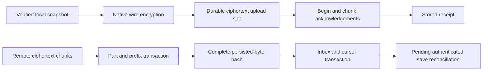

# Browser encrypted transfer journal source

This extends `WEB_SYNC_CRYPTO.md` and `WEB_SYNC_ACCOUNTS.md` with retained
ciphertext transfer/inbox storage and a resumable transport implementation.
No migration, IndexedDB/Blob/worker/hash/crypto/fetch operation, compiler,
browser, service, device or test was run. Browser crypto/network policies,
cloud opt-in, account UI and the full `encrypted_sync` capability remain off.
The authenticated reconciler, consent guards and foreground run controller are
now authored separately in `WEB_SYNC_RECONCILIATION.md`; they remain unqualified.

## Storage and ownership

Standalone IndexedDB schema 7 creates four stores without changing prior local
game/save/firmware records:

| Store | Purpose and bound |
| --- | --- |
| sync_slots | One upload and one download owner |
| sync_parts | At most 1,025 committed 256 KiB download parts |
| sync_inbox | At most 32 complete encrypted objects, keyed by account/object |
| sync_receipts | At most 20,000 upload acknowledgements, keyed by account/object |

`config/sync.transport.v1` binds the profile, account, device, revision UUID,
remote cursor, body-byte reservation and inbox count. Audit checks bounded row
counts, exact record/header shapes, account/device ownership, immutable Blob
lengths, contiguous parts, prefix length and quota arithmetic before admitting a
journal. Unrecognized or inconsistent staging is not guessed away. Every
mutation rechecks the current connected, registered credential generation in
the same transaction and compares the journal revision. The current extension
also requires the captured consent epoch/account/device context, and schema 8
adds global save ordering without changing these four cache store formats.

Account actions and transfer callers now share `withSyncLease`, retaining the
existing profile-specific lock name for compatibility. The helper uses an
exclusive, nonqueued Web Lock and issues an in-memory lease capability. A
callback's promise controls lock release under the [Web Locks
API](https://www.w3.org/TR/web-locks/#dom-lockmanager-request). The helper handles
cancellation after acquisition itself; it does not combine a request signal with
ifAvailable or steal another owner's lock. Scope exit/focus loss/hidden/page hide
abort the effective signal. Journal transactions and workers use that signal,
and expired lease capabilities cannot start new operations.

Mutations await strict transaction completion. The [IndexedDB durability
hint](https://w3c.github.io/IndexedDB/#dom-idbtransactionoptions-durability)
is the browser storage contract, not independent proof of filesystem/power-loss
behavior. Hashing, crypto and network work finish outside transactions. A failed
or uncertain write poisons that journal handle: reopening must inspect committed
state rather than assume an offset, rollback or publication outcome.

## Capacity accounting

The logical ciphertext reservation cap is 2 GiB. An upload reserves one complete
encrypted Blob. A download reserves twice its declared total, covering committed
parts and the complete inbox Blob during assembly. Publication exchanges that
reservation for one inbox body in the same transaction that removes the parts.
Inbox count is checked before starting a new download and again at publication.
Receipt metadata has its separate row cap.

Read-only status distinguishes actual retained body lengths from future reserved
capacity. The storage panel displays retained encrypted data and waiting inbox
objects; it does not report the unfilled reservation as bytes already stored.
These are application logical limits. Browser metadata/WAL/Blob representation,
deduplication, retention/GC, physical quota and total RSS remain unqualified.

## Upload path

`WebSaves.forSync` captures a checked origin, canonical-or-legacy metadata
fingerprint, payload revision and immutable Blob. A separate hash worker verifies
the actual payload before a second read confirms the same revision/fingerprint.
Captured/authenticated origins retain their canonical metadata; legacy projection
fingerprints remain explicitly noncanonical. No ancestry is invented.

The transport obtains the existing native Rust encrypted envelope. Staging checks
the actual ciphertext hash and atomically retains its header, nonce, transfer UUID,
metadata fingerprint and Blob before the first upload request. The original nonce
and bytes survive a retry rather than being regenerated after a lost response.
Local source identity is rechecked before subsequent sends and final receipt
publication. Plaintext is not placed in these stores.

The server's begin response supplies its authoritative received offset. Chunks
are read from the retained Blob and sent sequentially. A begin not-found may
rotate the transfer UUID once while retaining exactly the same ciphertext/header;
there is no repeated fallback loop. A complete byte count still requires commit
unless the service explicitly acknowledges an already stored object. The local
receipt is written and the upload slot released only after a matching stored
acknowledgement and current local identity check. This acknowledges the service's
response, not independent server durability.

A different retained save or immutable remote-content conflict is preserved and
reported rather than silently re-encrypted/overwritten. Explicit retirement can
abort the owned remote partial (or recognize not-found) and remove only that
local upload slot. A purged local save's receipt is removed in the existing local
purge transaction. Missing-local-source and unknown/corrupt-stage cleanup/recovery
still need the complete run/reconciliation policy; retained ciphertext is not
blindly destroyed as an orphan.

## Download, hash checkpoints and inbox

The transport requires resumable protocol 1 and the current exact object header.
HTTP chunk admission checks the object/header, range length and chunk SHA-256.
Each accepted chunk becomes an immutable Blob, and its part, new offset and
prefix checkpoint commit together. Progress uses committed offsets. Retrying a
failed write reopens committed state; an advanced in-memory hash is never treated
as a durable checkpoint.

`SyncHash` owns a bounded worker with the existing streaming SHA-256 implementation
and an added independent state clone for checkpoints. Resume streams the retained
parts once and compares the entire prefix checkpoint. Append transfers at most
one 256 KiB buffer. Deadlines, message identity, byte counts and lease cancellation
retire the worker on failure. Hashing stays outside the UI and database
transaction. These source rules have not been exercised with actual vectors or
workers.

At completion, the prefix must match the declared ciphertext hash. The complete
Blob assembled from persisted parts is hashed again before publication. This
checks actual retained bytes, not just the running network hash. A single strict
transaction then adds the complete inbox object, removes the slot/parts, updates
quota/count/revision and advances the associated cursor. A direct object fetch
with no sequence can retain an inbox object without moving the listing cursor.

Inbox transport integrity is not AEAD authentication. The remaining reconciler
must call the native Rust decrypt/metadata/payload verification before mapping or
publishing a local save. This module deliberately provides no unchecked inbox
delete/consume operation. Malformed/incomplete data cannot become a completed
local save merely because a cursor moved to its retained encrypted copy.

## Disconnect and lifetime

Credential disconnect now writes its generation tombstone, deletes the wrapping
key, clears the four encrypted-cache/receipt stores and removes transport state
in one transaction. Local library/save/origin/firmware stores are outside that
transaction. An old owner cannot restore a cleared cache through a late response.
Normal registration/certificate generations can reopen retained state for the
same account/device; another account/device is rejected.

The transport caller must own the full run guard, await its work, close HTTP and
journal owners, and retire delegated crypto when the run is finished. A retained
WASM heap is not claimed to shrink merely because its buffers were released.
Underlying browser read/network work may outlive a cancellation request; this
source does not claim to undo an already accepted server mutation. Scope fencing
prevents a retired script owner from publishing new local state.

## Source artifacts and outstanding work

`out/web-sync/crypto-v3-durable-journal-bounded` contains 177 source files /
1,129,293 bytes with retained recipe/lock/policy provenance. Earlier source
candidates remain preserved. The producer-snapshot name does not change the
crypto/account/resumable protocol 1 identities. All six product resource/
integration assemblies completed without cores; the final Web assembly includes
the added input bounds. No binary or distribution approval was produced.

The current extension connects authenticated canonical game/save mapping,
local publication followed by checked receipt/inbox completion, immutable
equivalence handling, known/suppressed cursor advancement, consent epoch guards,
foreground jobs and shared account UI controls. See
`WEB_SYNC_RECONCILIATION.md` for that frozen candidate and
`WEB_SYNC_RECOVERY.md` for the schema-9 request/purpose extension and its frozen
candidate. Old upload-stage identity/orphan recovery and runtime qualification
remain required.
The existing native/mobile code is not evidence that those Web paths work.

The final consolidated pass must cover schema upgrades/blocked/rollback behavior,
strict transaction lifecycle and crash/uncertain commits, live profile leases,
generation changes and simultaneous windows, source repair/purge races, full-size
quota accounting, partial/final Blob corruption, hash cloning/checkpoints/worker
termination, HTTP offset/expiry/lost-ack/commit behavior, inbox-before-cursor
atomicity, no plaintext in cache, disconnect and resumed credentials, physical
memory/storage and real supported browsers/devices. None of that was run. Every
other original browser/runtime/platform/streaming/sync/security/licensing/store/
release requirement remains active.
